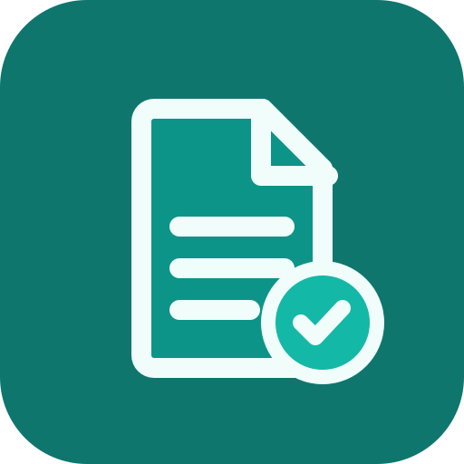

<div align="center">



# paperless-pdf

### A fully client-side, privacy-first PDF toolkit
**No file ever leaves your browser.**

[](https://github.com/IACBI/paperless-pdf/actions/workflows/ci.yml)
[](./LICENSE)
[](#-offline--pwa)
[](#-the-privacy-promise)
[](#-tech-stack)

**🌐 [Live demo](https://iacbi.github.io/paperless-pdf/)** &nbsp;·&nbsp; **English** | [Türkçe](#-türkçe)

</div>

---

Merge, split, compress, convert, rotate and OCR your PDFs **entirely on your device**.
Every operation runs in the browser with JavaScript and WebAssembly — there is no backend,
no upload, and no analytics. It's a Progressive Web App, so once loaded it keeps working
**offline**.

## ✨ Features

| Tool | What it does |
| --- | --- |
| 🧩 **Merge** | Combine multiple PDFs and **drag to reorder** or delete individual pages |
| ✂️ **Split** | Extract page ranges (`1-3, 5, 8-`) into one PDF or a ZIP of separate files |
| 🗜️ **Compress** | Shrink size by re-rendering pages as images, with DPI & quality sliders |
| 🖼️ **Images → PDF** | Turn JPG/PNG images into a PDF (reorderable, fit / A4 / Letter layouts) |
| 🌄 **PDF → PNG** | Export pages as PNG images at your chosen resolution (single file or ZIP) |
| 🔄 **Rotate** | Rotate any or all pages in 90° steps with a live preview |
| 🔎 **OCR** | Add an invisible, searchable text layer to scans — **on-device**, fully offline |

## 🔒 The privacy promise

> **No file ever leaves the browser.** All processing is local. No backend, no uploads, no
> analytics, no third-party requests carrying your data.

This isn't just a claim — it's enforced in code:

- ❌ No `fetch` / XHR / WebSocket / beacon ever carries your files, page images, or text.
- ❌ No analytics or telemetry SDKs of any kind.
- ✅ All engines (`pdf-lib`, `pdf.js`, `tesseract.js`) run in-browser.
- ✅ OCR's WebAssembly core **and** language data are **self-hosted** — so even OCR makes
  zero third-party requests and works completely offline.
- ✅ Results reach you only through a local download.
- ✅ Size limits protect your device: files over 200 MB or 1,000 pages (and merges over
  500 MB or 2,000 pages in total) are refused, and so is any page too large to render.
  You get a message instead of a frozen tab.

See [`CLAUDE.md`](./CLAUDE.md) for the full architecture and the rules that protect this
invariant.

## 🧱 Tech stack

[React](https://react.dev) · [Vite](https://vite.dev) · [TypeScript](https://www.typescriptlang.org)
· [Tailwind CSS v4](https://tailwindcss.com) ·
[pdf-lib](https://pdf-lib.js.org) (manipulation) ·
[pdf.js](https://mozilla.github.io/pdf.js/) (rendering) ·
[tesseract.js](https://tesseract.projectnaptha.com) (OCR) ·
[@dnd-kit](https://dndkit.com) (drag & drop) ·
[vite-plugin-pwa](https://vite-pwa-org.netlify.app) (offline) ·
[Vitest](https://vitest.dev) + [Playwright](https://playwright.dev) (tests).

## 🚀 Getting started

Requires **Node 18+** (developed on Node 24).

```bash
git clone https://github.com/IACBI/paperless-pdf.git
cd paperless-pdf
npm install      # also vendors the OCR assets (postinstall)
npm run dev      # http://localhost:5173
```

## 📜 Scripts

| Command | What it does |
| --- | --- |
| `npm run dev` | Start the Vite dev server |
| `npm run build` | Type-check and build to `dist/` |
| `npm run preview` | Preview the production build locally |
| `npm test` | Run unit tests (Vitest) |
| `npm run test:e2e` | Run end-to-end smoke tests (Playwright) |
| `npm run lint` | Lint with ESLint |
| `npm run format` | Format with Prettier |
| `npm run vendor:ocr` | (Re)vendor the self-hosted OCR assets |

## 🧪 Testing

- **Unit tests (Vitest):** the pure PDF logic in `src/lib/` — merge, split, rotate and
  images→PDF — verified with in-memory PDFs (no fixtures, no network).
- **End-to-end (Playwright):** real-browser smoke tests covering the privacy banner, a
  merge round-trip, an **OCR round-trip** that confirms the output PDF actually
  contains selectable text, and refusals for over-limit input.

```bash
npm test          # unit
npm run test:e2e  # browser e2e (builds, serves, drives Chromium)
```

## 📲 Offline / PWA

paperless-pdf is a Progressive Web App. After the first load, a service worker precaches the
app shell **and** the OCR engine + language data, so every tool — including OCR — works fully
offline. Install it to your home screen or desktop from the browser's install prompt.

## 🔤 OCR assets

OCR runs on self-hosted Tesseract assets (worker, WASM core, language data) under `public/`.
They are **not committed**; they are vendored automatically on `postinstall`, or manually:

```bash
npm run vendor:ocr
```

This copies the worker/core from `node_modules` and downloads `eng.traineddata.gz` into
`public/tessdata/`. To add a language, add its code to `LANGS` in
[`scripts/vendor-tesseract.mjs`](./scripts/vendor-tesseract.mjs) and to `OCR_LANGUAGES` in
[`src/lib/ocrLanguages.ts`](./src/lib/ocrLanguages.ts), then re-run the script. (The network
is only used to *download* the open-source language model to your machine — your documents
are never uploaded.)

## 🌍 Deploy to GitHub Pages

The app uses a relative base (`base: './'`) and `HashRouter`, so it runs correctly under a
project subpath like `https://iacbi.github.io/paperless-pdf/` with no extra config.

**Recommended — GitHub Actions (automatic):**

1. Push this repo to GitHub with the default branch named `main`.
2. In **Settings → Pages**, set **Source** to **GitHub Actions**.
3. Push to `main`. The workflow [`.github/workflows/deploy.yml`](./.github/workflows/deploy.yml)
   runs `npm ci` (which vendors the OCR assets), `npm test`, `npm run build`, and publishes `dist/`.

**Manual alternative:**

```bash
npm run vendor:ocr   # ensure OCR assets are present
npm run build        # outputs to dist/
npx gh-pages -d dist # publish dist/ to the gh-pages branch
```

## 🗂️ Project structure

```
src/
  lib/          Pure, framework-free PDF logic (unit-tested)
  components/   Reusable UI (dropzone, page grid, progress, privacy banner…)
  tools/        registry + one view per tool
  pages/        Home and routed tool pages
public/
  tesseract/    Self-hosted OCR worker + WASM core   (vendored)
  tessdata/     Language data, e.g. eng.traineddata  (vendored)
tests/e2e/      Playwright smoke tests
```

## 🤝 Contributing

Issues and pull requests are welcome. Before opening a PR, please run `npm run lint` and
`npm test`. Keep the **privacy invariant** intact — no feature may send user data anywhere.

## 📄 License

[MIT](./LICENSE) © 𝓐.𝓒.𝓑

<br />

---

<div align="center">

# 🇹🇷 Türkçe

### Tamamen tarayıcıda çalışan, gizlilik öncelikli PDF araç seti
**Hiçbir dosya cihazınızdan dışarı çıkmaz.**

[English](#paperless-pdf) | **Türkçe**

</div>

PDF'lerinizi **tamamen kendi cihazınızda** birleştirin, bölün, sıkıştırın, dönüştürün,
döndürün ve OCR ile aranabilir hale getirin. Her işlem tarayıcıda JavaScript ve WebAssembly
ile çalışır — sunucu yok, yükleme yok, analitik yok. Bir Progressive Web App (PWA) olduğu
için ilk açılıştan sonra **çevrimdışı** da çalışır.

## ✨ Özellikler

| Araç | Ne yapar |
| --- | --- |
| 🧩 **Birleştir** | Birden çok PDF'i birleştir, **sürükleyerek** sayfaları yeniden sırala veya sil |
| ✂️ **Böl** | Sayfa aralıklarını (`1-3, 5, 8-`) tek PDF veya ayrı dosyalardan oluşan ZIP olarak çıkar |
| 🗜️ **Sıkıştır** | Sayfaları görüntü olarak yeniden işleyip DPI & kalite kaydırıcılarıyla boyutu küçült |
| 🖼️ **Görsel → PDF** | JPG/PNG görselleri PDF'e çevir (sıralanabilir, sığdır / A4 / Letter düzeni) |
| 🌄 **PDF → PNG** | Sayfaları seçtiğin çözünürlükte PNG olarak dışa aktar (tek dosya veya ZIP) |
| 🔄 **Döndür** | Sayfaların herhangi birini veya hepsini canlı önizlemeyle 90°'lik adımlarla döndür |
| 🔎 **OCR** | Taramalara görünmez, aranabilir bir metin katmanı ekle — **cihazda**, tamamen çevrimdışı |

## 🔒 Gizlilik sözü

> **Hiçbir dosya tarayıcıdan dışarı çıkmaz.** Tüm işlemler yereldir. Sunucu yok, yükleme
> yok, analitik yok, verinizi taşıyan üçüncü taraf istekleri yok.

Bu yalnızca bir iddia değil, kodla güvence altına alınmıştır:

- ❌ Hiçbir `fetch` / XHR / WebSocket / beacon dosyalarınızı, sayfa görüntülerinizi veya
  metninizi taşımaz.
- ❌ Hiçbir analitik veya telemetri SDK'sı yoktur.
- ✅ Tüm motorlar (`pdf-lib`, `pdf.js`, `tesseract.js`) tarayıcıda çalışır.
- ✅ OCR'ın WebAssembly çekirdeği **ve** dil verisi **kendi sunucumuzda barındırılır** — yani
  OCR bile sıfır üçüncü taraf isteği yapar ve tamamen çevrimdışı çalışır.
- ✅ Sonuçlar size yalnızca yerel bir indirme ile ulaşır.
- ✅ Boyut sınırları cihazınızı korur: 200 MB'ı ya da 1.000 sayfayı aşan dosyalar (birleştirmede
  toplamda 500 MB veya 2.000 sayfa) reddedilir; işlenemeyecek kadar büyük sayfalar da öyle.
  Donmuş bir sekme yerine bir uyarı görürsünüz.

Mimarinin tamamı ve bu ilkeyi koruyan kurallar için [`CLAUDE.md`](./CLAUDE.md) dosyasına
bakın.

## 🧱 Teknolojiler

[React](https://react.dev) · [Vite](https://vite.dev) · [TypeScript](https://www.typescriptlang.org)
· [Tailwind CSS v4](https://tailwindcss.com) · [pdf-lib](https://pdf-lib.js.org) ·
[pdf.js](https://mozilla.github.io/pdf.js/) · [tesseract.js](https://tesseract.projectnaptha.com)
· [@dnd-kit](https://dndkit.com) · [vite-plugin-pwa](https://vite-pwa-org.netlify.app) ·
[Vitest](https://vitest.dev) + [Playwright](https://playwright.dev).

## 🚀 Başlangıç

**Node 18+** gerekir (Node 24 ile geliştirildi).

```bash
git clone https://github.com/IACBI/paperless-pdf.git
cd paperless-pdf
npm install      # OCR varlıklarını da hazırlar (postinstall)
npm run dev      # http://localhost:5173
```

## 📜 Komutlar

| Komut | Açıklama |
| --- | --- |
| `npm run dev` | Vite geliştirme sunucusunu başlat |
| `npm run build` | Tip kontrolü yap ve `dist/` klasörüne derle |
| `npm run preview` | Üretim derlemesini yerelde önizle |
| `npm test` | Birim testlerini çalıştır (Vitest) |
| `npm run test:e2e` | Uçtan uca testleri çalıştır (Playwright) |
| `npm run lint` | ESLint ile denetle |
| `npm run format` | Prettier ile biçimlendir |
| `npm run vendor:ocr` | Kendi sunucuda barındırılan OCR varlıklarını (yeniden) hazırla |

## 🧪 Testler

- **Birim testleri (Vitest):** `src/lib/` içindeki saf PDF mantığı — birleştirme, bölme,
  döndürme ve görsel→PDF — bellek içi PDF'lerle doğrulanır (fixture yok, ağ yok).
- **Uçtan uca (Playwright):** gizlilik bildirimi, birleştirme turu ve çıktının gerçekten
  seçilebilir metin içerdiğini doğrulayan bir **OCR turu** ve sınır aşan dosyaların
  reddedilmesi için gerçek tarayıcı testleri.

## 📲 Çevrimdışı / PWA

paperless-pdf bir Progressive Web App'tir. İlk yüklemeden sonra bir service worker uygulama
kabuğunu **ve** OCR motoru ile dil verisini önbelleğe alır; böylece OCR dahil her araç
tamamen çevrimdışı çalışır. Tarayıcının kurulum istemiyle ana ekranınıza ekleyebilirsiniz.

## 🔤 OCR varlıkları

OCR, `public/` altında kendi sunucumuzda barındırılan Tesseract varlıklarıyla (worker, WASM
çekirdeği, dil verisi) çalışır. Bunlar depoya **eklenmez**; `postinstall` ile otomatik veya
elle hazırlanır:

```bash
npm run vendor:ocr
```

Yeni bir dil eklemek için kodunu [`scripts/vendor-tesseract.mjs`](./scripts/vendor-tesseract.mjs)
içindeki `LANGS` listesine ve [`src/lib/ocrLanguages.ts`](./src/lib/ocrLanguages.ts) içindeki
`OCR_LANGUAGES` listesine ekleyip betiği yeniden çalıştırın. (Ağ yalnızca açık kaynak dil
modelini cihazınıza *indirmek* için kullanılır — belgeleriniz asla yüklenmez.)

## 🌍 GitHub Pages'e dağıtım

Uygulama göreli bir taban (`base: './'`) ve `HashRouter` kullanır; bu yüzden
`https://iacbi.github.io/paperless-pdf/` gibi bir alt yolda ek ayar olmadan çalışır.

**Önerilen — GitHub Actions (otomatik):**

1. Depoyu varsayılan dalı `main` olacak şekilde GitHub'a gönderin.
2. **Settings → Pages** bölümünde **Source** olarak **GitHub Actions** seçin.
3. `main`'e push yapın. [`.github/workflows/deploy.yml`](./.github/workflows/deploy.yml) iş
   akışı `npm ci`, `npm test`, `npm run build` çalıştırır ve `dist/`'i yayınlar.

**Elle alternatif:**

```bash
npm run vendor:ocr
npm run build
npx gh-pages -d dist
```

## 🤝 Katkı

Hata bildirimleri ve PR'lar memnuniyetle karşılanır. PR açmadan önce `npm run lint` ve
`npm test` çalıştırın. **Gizlilik ilkesini** koruyun — hiçbir özellik kullanıcı verisini
dışarı göndermemelidir.

## 📄 Lisans

[MIT](./LICENSE) © 𝓐.𝓒.𝓑
